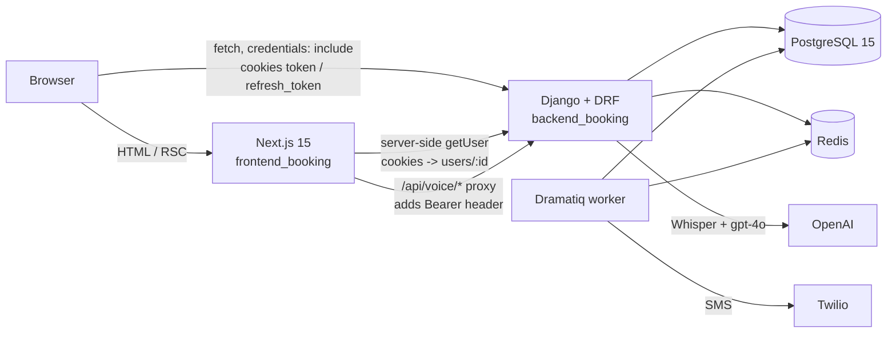

# 01 — Current State & Findings

**Scope:** `frontend_booking` (Next.js 15) and `backend_booking` (Django 5 / DRF), as of 2026-11-23.
**Goal of the initiative:** collapse the two deployables into one Next.js application with no separate backend API.

---

## 1. System as it exists today

Two repos, two deployments, two CI pipelines, and four runtime processes (Next, gunicorn, dramatiq worker, Redis) plus Postgres. Cross-origin cookies (`SameSite=None`, shared `.lichnails.co.uk` domain) exist only because the API lives on a different host.

## 2. Backend inventory (what must be re-homed)

### 2.1 Endpoints actually consumed by the frontend

| Method | Path | Django view | Notes |
|---|---|---|---|
| POST | `users/login/` | `CustomLoginView` (dj-rest-auth) | Sets `token` (1 h) + `refresh_token` (7 d) httpOnly cookies, returns `{ user }` |
| POST | `users/logout/` | `CustomLogoutView` | Clears both cookies, `AllowAny` |
| POST | `token/refresh/` | SimpleJWT `TokenRefreshView` | Body `{ refresh }` -> `{ access }`; used server-side by `getUser` |
| GET / PATCH | `users/:id/` | `UserDetails` | GET returns `{ user: {...} }` (wrapped); PATCH returns the user unwrapped |
| GET / POST | `appointments/` `?date=YYYY-MM-DD` | `AppointmentListCreateAPIView` | Flat array, filtered by `appointment_time__date` |
| PATCH / DELETE | `appointments/:id/` | `AppointmentDetailUpdateDeleteView` | DELETE -> 204 |
| GET / POST | `customers/` `?salon=&sort_by=&order=` | `CustomerListCreateAPIView` | Flat array; `salon_ids` write-only, `salons` nested read-only |
| GET / PATCH / DELETE | `customers/:id/` | `CustomerDetailUpdateDeleteView` | |
| GET / POST | `salons/` | `SalonListCreateAPIView` | Flat array (pagination is disabled, despite frontend `ListSalonsResponse` expecting `results`) |
| GET / PATCH / DELETE | `salons/:id/` | `SalonDetailUpdateDeleteView` | Nested `addresses` write |
| POST | `voice/transcribe/` | `TranscribeView` | multipart `audio` (max 10 MB, webm/mp4/...) + `language` -> `{ text }` via Whisper |
| POST | `voice/chat/` | `ChatView` | `{ message, conversation_history }` -> `{ reply, conversation_history, appointments? }` |

Not consumed by the frontend but present: `users/register/`, `users/?salon=`, `/admin/`, `/health/`.

### 2.2 Data model (Django tables, default naming)

| Table | Columns of interest |
|---|---|
| `user_extendeduser` | `email` (unique, login id), `password` (Django PBKDF2-SHA256 hash), `first_name`, `last_name`, `full_name`, `phone_number` (E.164 varchar), `is_staff`, `is_owner`, `is_active`, `is_superuser`, `last_login`, `date_joined`, `created`, `modified` |
| `user_extendeduser_salons` | M2M user <-> salon |
| `user_extendeduser_addresses` | M2M user <-> address (unused by UI) |
| `salon_salon` | `name`, `phone_number`, `reminder_time_minutes` (default 60), `created`, `modified` |
| `salon_salon_addresses` | M2M salon <-> address |
| `address_address` | `street`, `city`, `postal_code` (UK format validated), `created`, `modified` |
| `customer_customer` | `full_name`, `phone_number`, `created`, `modified` |
| `customer_customer_salons` | M2M customer <-> salon |
| `appointment_appointment` | `salon_id`, `user_id`, `customer_id`, `appointment_time` (tz), `end_time` (tz, nullable), `column_id` (1-5), `comment`, `task_id` (Dramatiq message id), `created`, `modified` |

Also present but not business data: Django auth/admin/session/allauth/sites/authtoken tables. These can be ignored.

### 2.3 Side effects hidden in `Appointment.save()` / `delete()`

These are the only "background" behaviours in the system and are easy to lose in a port:

1. **Confirmation SMS** on create, and again when `appointment_time` changes.
2. **Reminder SMS** scheduled `salon.reminder_time_minutes` before `appointment_time` (Dramatiq delayed message; id stored in `task_id`). Rescheduled on every save; cancelled via a raw Redis `HDEL` when `task_id` is set.
3. **Cancellation SMS** on delete.
4. Nothing is sent if the customer has no phone number.

Message templates live in `appointment/tasks.py`.

### 2.4 Voice booking (`booking_api/voice/`)

- **Transcription:** OpenAI `whisper-1`, `language` default `en`.
- **Chat:** OpenAI `gpt-4o` with function calling, `tool_choice: "auto"`, max 5 tool rounds, four tools: `lookup_customer`, `create_customer`, `check_availability`, `create_appointment`. Tool executor runs against the ORM and is scoped to `request.user.salons.first()`.
- **Wire format:** `conversation_history` is the raw OpenAI message list (roles `user | assistant | tool | system`, `tool_calls`, `tool_call_id`). The frontend stores and echoes it unchanged (`types/voice.ts` calls it "opaque").
- **Prompt:** UK-phone normalisation rules, default 60-minute duration, 5 columns, current date injected per request.
- Availability check: overlap on the same `salon + column_id + date`; `end_time` falls back to +60 min.

### 2.5 Auth mechanics

- SimpleJWT HS256 tokens signed with `DJANGO_SECRET_KEY`. Access claims: `token_type=access`, `exp`, `iat`, `jti`, `user_id`.
- Cookie names `token` / `refresh_token`; httpOnly, Secure, `SameSite=None`, `Domain=.lichnails.co.uk` in production.
- Server components in Next decode (not verify) the access token with `jsonwebtoken`, refresh it if expired, then fetch the user. The refreshed access token is **not** written back to the cookie jar (server components cannot set cookies), so every RSC render after expiry repeats the refresh call.

### 2.6 Infrastructure

- Backend: Docker image (gunicorn 3x2), entrypoint runs `migrate` + `seed_data`; `docker-compose` with Postgres 15, Redis 7, web, worker. `/health/` targets an AWS ALB/ECS deployment.
- Frontend: Vercel-style (`@vercel/analytics`), origin `https://usa-berko.lichnails.co.uk`.
- Backend CI: pre-commit (black/flake8/ruff) + pytest. Frontend: no tests, `next lint` only.

## 3. Findings

### 3.1 Security gaps in the current API (must be fixed, not ported)

| # | Finding | Evidence |
|---|---|---|
| F1 | **CRUD endpoints are unauthenticated.** `REST_FRAMEWORK` sets no `DEFAULT_PERMISSION_CLASSES`, so DRF's default `AllowAny` applies to salons, customers, appointments, and `users/:id` GET/PATCH. Only the voice views declare `IsAuthenticated`. | `booking_api/settings.py`, `*/views.py` |
| F2 | **No tenant scoping.** Any caller can list/modify any salon's customers and appointments; `?salon=` is a filter the client chooses, not a constraint. | `customer/views.py`, `appointment/views.py` |
| F3 | **Any user can PATCH any user** (`IsTokenOwnerOrAdmin` exists but is commented out). | `user/views.py` |
| F4 | **Open registration** at `users/register/` creates accounts with arbitrary salon membership. | `user/views.py` |

### 3.2 Defects / inconsistencies worth knowing

| # | Finding |
|---|---|
| D1 | `SalonSerializer.create/update` calls `Address.objects.create(salon=salon, ...)` but `Address` has no `salon` field. Creating a salon, or PATCHing `addresses` without an `id` (which is what the Dashboard address form sends), will raise `TypeError`. Verify in staging before assuming the dashboard address edit works today. |
| D2 | Frontend `ListSalonsResponse` expects `{ results }`; the API returns a flat array (pagination disabled). Unused by the current UI. |
| D3 | `GET users/:id` returns `{ user }` but `PATCH users/:id` returns the bare user. Frontend already handles both; the port should keep the asymmetry or fix both sides together. |
| D4 | `task_id` is serialised to clients and typed in `BookingData` but never read by the UI. |
| D5 | Frontend `getUser` fetches `users/{id}` without a trailing slash and relies on Django's `APPEND_SLASH` redirect. |
| D6 | Appointment times are treated as **UTC wall-clock** end to end (`...T09:00:00Z` from the form, `dayjs.utc` on display). Django `TIME_ZONE=UTC`. The tool executor's `timezone.make_aware` also yields UTC. This must stay consistent in the port. |
| D7 | Access-token refresh inside server components is effectively repeated on each render after the first hour, because the new token is never persisted (see 2.5). |

### 3.3 What is genuinely reusable

- The **database** is plain Postgres with sane relational modelling; it can be adopted as-is.
- **Password hashes** are PBKDF2-SHA256 in Django's `algorithm$iterations$salt$hash` format, verifiable with Node's `crypto.pbkdf2`.
- **JWTs** are standard HS256; Node (`jose`) can verify and mint tokens Django would also accept during a dual-run period.
- The **frontend data layer** (`src/api -> src/hooks -> components`) is already structured so that only the base URL and a few server-only helpers need to change.
- The **voice prompt, tool schemas and executor rules** translate one-to-one into TypeScript.

### 3.4 What is not worth carrying over

- Django admin, allauth/dj-rest-auth registration, `authtoken`, `sites`, sessions, CORS/CSRF/CIDR middleware.
- Redis, Dramatiq, and the `task_id` cancellation dance. A reminder can be derived from data instead of scheduled as a message (see 02 section 7).
- Cross-subdomain cookie configuration.
