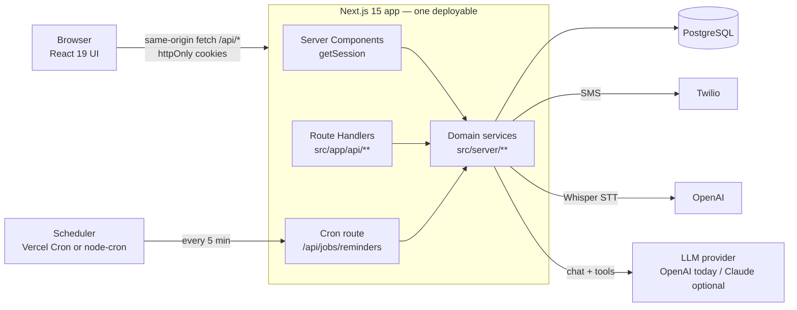
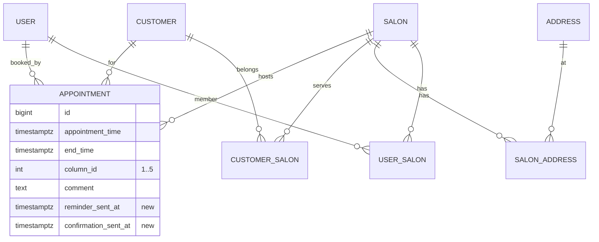
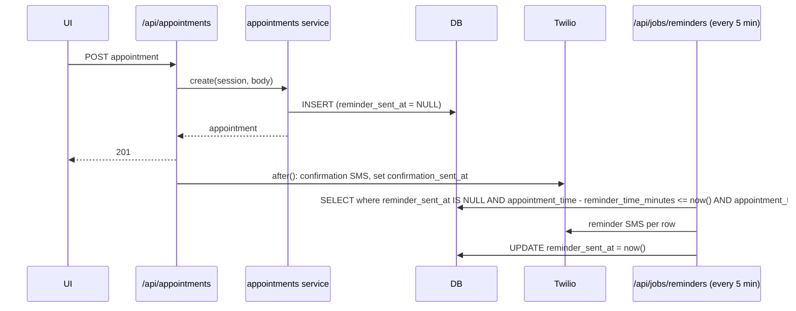
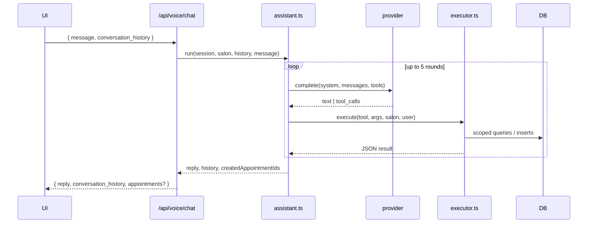

# 02 — Target Architecture: Single Next.js Application

**Status:** Proposed (2026-11-23). Supersedes the split frontend/backend design once the plan in `03-migration-plan.md` completes.

---

## 1. Shape of the system



One process, one repo, one CI pipeline, one database. Redis, the worker, gunicorn, Django admin and CORS disappear. The browser contract stays REST over `/api/*` so the existing `src/api -> src/hooks -> components` layers survive with a base-URL change.

## 2. Guiding principles

1. **Preserve the wire contract first, improve it second.** Every ported route returns the same JSON shape (snake_case, DRF-style field errors) so the UI keeps working during the migration. Clean-ups come after cutover.
2. **Adopt the existing database.** Same Postgres instance, same tables, same IDs, same password hashes. No ETL, and Django and Next can run side by side against it during the strangler phase.
3. **Thin handlers, fat services.** Route handlers only parse, authenticate, call a service, and serialise. Services are plain TypeScript functions that take a `Session` and a DB handle, so server components, route handlers, the voice tool executor and the cron job share one code path.
4. **Tenancy is enforced in the service layer, not trusted from the client.** Every query is scoped to the salons in `session.user.salons`. This closes findings F1-F3.
5. **Derive, don't schedule.** Reminders are computed from `appointment_time - reminder_time_minutes` by a periodic job, with an idempotency column, instead of scheduling a message per appointment.

## 3. Module layout

```
src/
  app/
    (protected)/...                 unchanged UI routes
    login/                          unchanged
    api/
      auth/login/route.ts           POST
      auth/logout/route.ts          POST
      auth/refresh/route.ts         POST  (kept for parity; RSC path no longer needs it)
      users/[id]/route.ts           GET, PATCH
      salons/route.ts               GET, POST
      salons/[id]/route.ts          GET, PATCH, DELETE
      customers/route.ts            GET, POST
      customers/[id]/route.ts       GET, PATCH, DELETE
      appointments/route.ts         GET, POST
      appointments/[id]/route.ts    PATCH, DELETE
      voice/transcribe/route.ts     POST  (becomes real, no longer a proxy)
      voice/chat/route.ts           POST
      jobs/reminders/route.ts       GET/POST, cron-secret protected
      health/route.ts               GET
      [...path]/route.ts            TEMPORARY strangler proxy to Django (deleted at cutover)
  server/                           import "server-only" at the top of every file
    db/
      client.ts                     drizzle(pg pool) singleton
      schema.ts                     tables (introspected from Django, then curated)
      migrations/                   drizzle-kit SQL migrations for post-adoption changes
    auth/
      password.ts                   Django PBKDF2-SHA256 verify + hash
      jwt.ts                        jose HS256 sign/verify, SimpleJWT-compatible claims
      cookies.ts                    set/clear token + refresh_token
      session.ts                    getSession() for RSC, requireSession() for handlers
    services/
      users.ts  salons.ts  customers.ts  appointments.ts
    sms/
      twilio.ts  templates.ts  reminders.ts
    voice/
      assistant.ts                  tool-call loop (provider-agnostic)
      tools.ts                      tool schemas (zod) + JSON Schema export
      executor.ts                   lookup/create customer, availability, booking
      prompts.ts
      providers/openai.ts           default provider (ports gpt-4o behaviour)
      providers/anthropic.ts        optional provider (see section 8)
      transcribe.ts                 Whisper via openai SDK
    http/
      errors.ts                     ApiError -> DRF-shaped JSON
      respond.ts                    json(), noContent(), handle() wrapper
  lib/validation/                   zod schemas shared by client forms and route handlers
  api/, hooks/, stores/, components/   unchanged (base URL only)
```

`src/api/userApi.ts` (the server-only fetch to Django) is replaced by `server/auth/session.ts`, which reads the cookie, verifies the JWT and loads the user from the DB directly. No HTTP hop for RSC auth.

## 4. Data access

### 4.1 Decision: Drizzle ORM on the existing Postgres schema

- `drizzle-kit pull` introspects the live Django schema into `schema.ts`; Django's default table names (`appointment_appointment`, `user_extendeduser_salons`, ...) are kept and aliased in TypeScript (`export const appointments = pgTable("appointment_appointment", ...)`).
- Node driver: `pg` with a small pool for a long-lived container, or Neon/Supabase serverless driver if deployed to Vercel. Drizzle supports both behind the same query API.
- Why Drizzle over Prisma: no query engine binary, lower cold start, SQL-shaped queries that map cleanly onto the existing DRF filters (`appointment_time::date = $1`), and introspection that keeps Django's names. Prisma would also work; it is the fallback if the team prefers its client ergonomics.

### 4.2 Schema changes (additive, applied via drizzle migrations after adoption)

| Change | Reason |
|---|---|
| `appointment_appointment.reminder_sent_at timestamptz NULL` | Idempotency for the reminder job (replaces `task_id`) |
| `appointment_appointment.confirmation_sent_at timestamptz NULL` | Observability + safe retry of confirmation SMS |
| Index `(salon_id, appointment_time)` | Day view and availability queries |
| Index `(phone_number)` on `customer_customer` | Voice lookup by phone |
| Later: drop `task_id`, drop Django-only tables (`django_*`, `auth_*`, `account_*`, `socialaccount_*`, `authtoken_*`) | Clean-up after Django is decommissioned |

Table renames to idiomatic names are **optional** and deferred; they are cosmetic and carry migration risk.

### 4.3 Entity model (unchanged semantics)



## 5. Authentication & authorization

### 5.1 Decision: own minimal JWT-in-cookie auth, compatible with SimpleJWT

Auth.js/Clerk were rejected: the product is credentials-only, staff accounts are created by owners, and the existing cookie/JWT scheme is simple and already understood by the UI. Keeping the SimpleJWT format allows Django-issued cookies to remain valid during dual-run.

| Concern | Design |
|---|---|
| Signing | `jose` HS256 with `AUTH_SECRET`. During migration `AUTH_SECRET = DJANGO_SECRET_KEY`; rotate after Django is gone. |
| Claims | `{ token_type, user_id, jti, iat, exp }` to match SimpleJWT. Access 60 min, refresh 7 days. |
| Cookies | `token`, `refresh_token`; `HttpOnly`, `Secure`, `Path=/`, **`SameSite=Lax`**, no `Domain` (same origin now). |
| Passwords | `password.ts` parses `pbkdf2_sha256$<iter>$<salt>$<b64>` and verifies with `crypto.pbkdf2`. New/changed passwords are written in the same format so the DB stays Django-readable until cutover. |
| RSC session | `getSession()` verifies the access cookie; if expired but refresh is valid, it loads the user anyway and lets `middleware.ts` (or the next route handler) rotate the cookies. Fixes D7 without needing cookie writes from RSC. |
| Handler guard | `requireSession()` throws `ApiError(401, { detail: "Authentication credentials were not provided." })` — same text the UI matches on today. |
| Login hardening | Constant-time compare, generic error message, basic per-IP rate limit (in-memory or Upstash later). |

### 5.2 Authorization rules (new; close F1-F4)

| Resource | Rule |
|---|---|
| Salon | Readable/updatable only if `salon.id in session.user.salons`. Create/delete: `is_owner`. |
| Customer, Appointment | All queries add `salon_id IN (session salons)`. Writes validate the body's `salon` / `salon_ids` against the same set. |
| User | GET/PATCH self; owners may GET/PATCH users in their salons. `is_owner`, `is_staff`, `is_active` editable by owners only. |
| Registration | Removed from the public API. Owner-only `POST /api/users` creates staff for the owner's salons (future UI). |
| Jobs | `/api/jobs/*` require `Authorization: Bearer ${CRON_SECRET}`. |

## 6. HTTP contract and validation

- **Request validation:** zod schemas in `src/lib/validation/` mirror DRF serializers (E.164 phone, UK postcode, `appointment_time` not in the past, `column_id` 1-5, non-empty `salon_ids`). The same schemas can later back `react-hook-form` resolvers client-side.
- **Error shape:** keep DRF's conventions because the client parses them:
  - validation: `400 { "<field>": ["message"] }`
  - auth: `401 { "detail": "..." }`
  - not found: `404 { "detail": "Not found." }`
  - domain errors (voice): `{ "error": "..." }`, `502` for upstream provider failures.
- **Dates:** ISO 8601 with `Z`; `?date=YYYY-MM-DD` filters on the UTC date (`appointment_time AT TIME ZONE 'UTC'`), matching Django `TIME_ZONE=UTC`. See finding D6.
- **Trailing slashes:** `next.config.js` `trailingSlash` left as-is; handlers accept both forms by registering routes without slashes and letting Next normalise (fixes D5).
- **Response shapes preserved verbatim** for the first release: flat arrays for lists; `{ user }` wrapper on `GET /api/users/:id`; `task_id: ""` kept in appointment payloads until the frontend type is updated.

## 7. Side effects and background work

### 7.1 Decision: inline SMS + periodic reminder sweep (no queue)



| Behaviour today | Target |
|---|---|
| Confirmation SMS on create / time change | Sent from the service via Next 15 `after()` so the response is not delayed; failures logged, `confirmation_sent_at` left NULL for a retry sweep. |
| Reminder scheduled per appointment, cancelled on change | `reminder_sent_at` column + sweep. On time change, the service resets `reminder_sent_at = NULL` so the sweep recomputes. Deleting the row removes the reminder implicitly. |
| Cancellation SMS on delete | Sent inline via `after()` before/after the DELETE commits. |
| Skip if customer has no phone | Preserved in `sms/templates.ts` guards. |

Scheduler options: **Vercel Cron** (`vercel.json`, hits the route with `CRON_SECRET`) when hosted on Vercel; **node-cron inside the Next server** or a host-level cron when running the Docker image. The 5-minute cadence means a reminder can fire up to 5 minutes later than the configured offset; acceptable for 15 min-24 h offsets. Reduce to 1 minute if needed.

Upgrade path if volume grows: swap `after()` for an outbox table drained by the same cron, or adopt Inngest/QStash. The service interface does not change.

## 8. Voice booking

### 8.1 Transcription

OpenAI Whisper via the official `openai` Node SDK (`client.audio.transcriptions.create`). Route handler reads `request.formData()`, enforces the 10 MB and MIME allow-list from the Django serializer, and returns `{ text }`. Anthropic does not offer speech-to-text, so this stays on OpenAI regardless of the chat provider.

### 8.2 Chat assistant — provider-agnostic loop



- `tools.ts` defines the four tools once as zod schemas; JSON Schema is derived for whichever provider is active. `strict`/`additionalProperties:false` preserved.
- `executor.ts` is a line-for-line port of `tool_executor.py` on top of the appointments/customers services (so tenancy and SMS side effects are identical to manual bookings).
- `conversation_history` remains opaque to the UI. Its internal format is provider-specific, so a provider switch is a **breaking change for in-flight conversations only**; the UI already offers "New conversation", and the route can return `400 { error: "conversation_reset" }` when it detects an incompatible history.

### 8.3 Provider choice — OPEN DECISION

| Option | Pros | Cons |
|---|---|---|
| **A. OpenAI `gpt-4o` (port as-is)** — recommended for phase 3 | Zero behaviour change; prompt and tool loop already tuned; keeps `conversation_history` format byte-compatible with Django during dual-run | Two vendor keys (OpenAI for both STT and chat is actually one key) |
| **B. Anthropic Claude (`claude-opus-5-5`, `@anthropic-ai/sdk`)** | Strong tool-use; adaptive thinking; one provider interface already planned | Requires prompt re-tuning and eval pass; history format changes; Whisper still needs OpenAI |

Recommendation: ship **A** first to de-risk the migration, keep `providers/anthropic.ts` as a thin second implementation behind `VOICE_PROVIDER=openai|anthropic`, and evaluate B after cutover with a small transcript-based eval. If B is adopted: Messages API with `tools` + `tool_choice: auto`, `strict: true` on each tool, `thinking: { type: "adaptive" }`, server-side `fallbacks: "default"`, and `max_tokens` around 4k for this short-reply workload.

Route handler runtime: Node (not Edge), `export const maxDuration = 60` for chat and transcribe.

## 9. Configuration

| Variable | Purpose |
|---|---|
| `DATABASE_URL` | Postgres connection (same DB Django uses during migration) |
| `AUTH_SECRET` | JWT HS256 secret (= `DJANGO_SECRET_KEY` until cutover, then rotated) |
| `CRON_SECRET` | Bearer token for `/api/jobs/*` |
| `TWILIO_ACCOUNT_SID`, `TWILIO_AUTH_TOKEN`, `TWILIO_PHONE_NUMBER` | SMS |
| `OPENAI_API_KEY`, `OPENAI_MODEL=gpt-4o`, `OPENAI_WHISPER_MODEL=whisper-1` | Voice |
| `ANTHROPIC_API_KEY`, `VOICE_PROVIDER` | Optional provider B |
| `LEGACY_API_URL` | Django base URL for the temporary strangler proxy; removed at cutover |
| `NEXT_PUBLIC_API_URL` | Set to `/api/` during migration, then removed in favour of a hard-coded relative base |

Config is validated once at boot with zod (`src/server/env.ts`) so a missing secret fails fast.

## 10. Deployment

| Option | Fit |
|---|---|
| **Vercel + managed Postgres (Neon/Supabase, or existing RDS with a pooler)** — recommended | Native cron, `maxDuration`, zero servers to patch. Matches the frontend's current hosting. |
| **Single Docker container (`next start`) on the existing AWS host** | Reuses infra and RDS; needs `node-cron` in-process or a host cron, and a health route. Still one deployable. |

Either way: `GET /api/health` performs `SELECT 1`; seed is a `yarn db:seed` script porting `seed_data.py`; migrations run via `yarn db:migrate` in CI/CD before deploy.

## 11. Testing strategy (new; the frontend has none today)

| Layer | Tool | Scope |
|---|---|---|
| Unit | Vitest | password/JWT compat (fixtures generated by Django), zod schemas, SMS templates, reminder window maths, availability overlap |
| Integration | Vitest + Postgres (docker compose `db` or Testcontainers) | services + route handlers via `fetch` against `next dev`/`next start`; contract snapshots recorded from Django responses to prove parity |
| E2E | Playwright | login, create appointment on day view, voice chat with mocked provider |
| CI | GitHub Actions | lint, typecheck, unit, integration (service container for Postgres) |

## 12. Decision log

| ID | Decision | Alternatives rejected |
|---|---|---|
| AD-1 | Route Handlers keeping the REST contract | Server Actions rewrite (UI churn, no strangler path); separate Node API (still two apps) |
| AD-2 | Adopt existing Postgres schema in place | SQLite/libsql (data migration, concurrency); fresh schema + ETL (no dual-run, ID remapping) |
| AD-3 | Drizzle ORM | Prisma (acceptable fallback); raw SQL (no types/migrations) |
| AD-4 | Own JWT cookie auth, SimpleJWT-compatible | Auth.js (credentials-only overhead), Clerk/Supabase Auth (vendor lock, user-table migration) |
| AD-5 | Inline SMS via `after()` + cron sweep with idempotency columns | Redis + BullMQ (keeps infra we are removing); Inngest (fine later, extra vendor now) |
| AD-6 | OpenAI first for voice chat, provider interface for Claude | Switch providers mid-migration (compounds risk) |
| AD-7 | zod validation, DRF-shaped error bodies | Ad-hoc checks; new error envelope (breaks UI parsing) |

## 13. Open questions for the owner

1. Hosting: Vercel + managed Postgres, or keep the AWS host and run one container?
2. Voice chat provider after cutover: stay on OpenAI, or evaluate Claude (section 8.3)?
3. Should owner-managed staff creation (`POST /api/users`) be in scope for this migration or a follow-up?
4. Is the dashboard address edit known to work today? (Finding D1 suggests it may 500.)
5. Reminder cadence: is a 5-minute sweep granularity acceptable?
